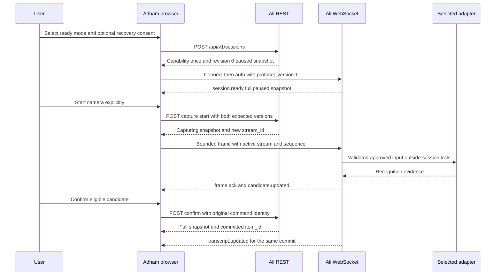
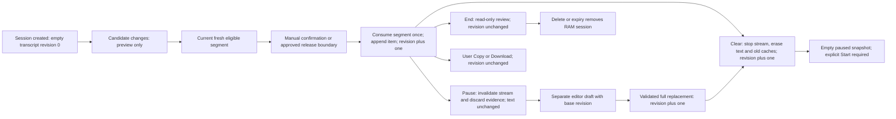

# Runtime data flow and transcript lifecycle

Owner: Hisham with Ali and Adham. Sources: Ali §§6–24, Adham §§5–25, Osama §§1–4/24, Bavly §§1–2/16/24/26. Public API modes are exactly `alphabet` and `word`; package path `ml/words/` does not change the wire value.

## Camera to prediction

```mermaid
flowchart LR
  gesture["Explicit Start gesture"] --> camera["Camera permission and usable video"]
  camera --> sampler["Unmirrored bounded JPEG with sequence and monotonic capture time"]
  sampler --> socket["Authenticated v1 WebSocket; one frame in flight"]
  socket --> validate["Ali validates bytes, JPEG, dimensions, rate and current stream"]
  validate --> worker["Bounded decoding, approved preprocessing and ordered model window"]
  worker --> adapter["Selected alphabet or word adapter"]
  adapter --> current["Recheck live session, capture status and stream generation"]
  current --> preview["Candidate preview with eligibility and expiry"]
  preview --> confirm["Manual Confirm or evaluated automatic release"]
  confirm --> commit["Atomic consume-once transcript commit in RAM"]
  commit --> snapshot["Canonical snapshot to REST response and WebSocket"]
```

Start requires a successfully authenticated socket and current `expected_revision` plus `expected_state_version`. Every start issues a new server `stream_id`; the browser resets `frame_seq` to 1. Mirror only the visual preview, never transmitted samples under v1. Encode with aspect ratio preserved; the adapter applies its trained crop/resize/normalization. A browser JPEG encode completing after a local stop must be discarded.

Initial engineering limits, not measured performance: 640×480 maximum, 163,840 decoded JPEG bytes, 262,144 UTF-8 message bytes, negotiated maximum initially 10 samples/second. Browser admits one sample until the matching `(stream_id, frame_seq)` acknowledgement; the server permits one bounded pending sample and only the approved model window (initial upper bound 60). Gaps over 500 ms initially reset temporal evidence. Do not duplicate frames, create offline replay, or downsample below a model's evaluated rate without a new agreement.

Use one socket reader, a bounded inference worker and one serialized outbound writer. Inference and expensive decoding run outside the session lock and asynchronous socket loop. Reacquire the session lock to validate generation and commit. A timeout does not kill native work: keep its capacity slot until it finishes and discard stale output. A stuck runtime can require a restart and loss of RAM sessions. No alternate service is introduced to avoid this decision.

## Frontend/backend communication

REST and socket responses may arrive in either order. The frontend independently merges `transcript.revision` for text and `state_version` for capture state; `event_seq` orders socket events. It also checks session identity, local connection generation and deletion barriers. A cached success resolves a pending command without rolling the display back. Deadline-only updates at equal versions need the explicit ordering decision in [open questions](decisions/open-questions.md).

## Transcript lifecycle

A candidate is recognition evidence, not stored transcript content. Manual confirmation requires capturing status, the current stream, an eligible unexpired candidate and an unconsumed segment. Consume the segment under the same per-session lock as the append. Simultaneous confirms cannot both succeed, including different command keys. A held letter/word adds once. A genuine release or explicit manual Pause/Start boundary permits a deliberate identical next sign. Comparing with the last text or using a cooldown alone is incorrect.

The word gate has `WAIT_RELEASE`, `IDLE`, `TRACKING`, `ELIGIBLE` and `LOCKED` states. Automatic streams begin waiting for evaluated neutral release. Manual streams may start at IDLE because Start is an explicit boundary. Initial entry/exit scores 0.85/0.65, stability ≥300 ms and ≥3 valid observations, neutral dwell ≥300 ms and candidate support expiry 2 seconds are starting settings for evaluation, never fixed scientific claims. Unknown, absent hands, low confidence, transitions and genuine neutral are distinct. Scores between exit and entry do not advance stability. Automatic release keeps the last eligible word only within freshness; broken evidence discards it.

Pause, Clear, disconnect, End, deletion, expiry, invalid generation and continuity breaks cancel pending windows/candidates and reject late results. **Pause never flushes a last classification.** The manual fallback is preview → Confirm success → Pause → explicit Start for the next sign. It still requires a model compatible with the actual live window; a trimmed-clip-only model may remain blocked.

Word text joins nonempty items with one ordinary space; a phrase label remains one item. Alphabet text concatenates letter/manual strings and explicit space items. Preserve logical Arabic Unicode order with NFC and LF line endings; do not reverse strings or strip meaningful Arabic distinctions. User edits lose model provenance when changed; they do not become training examples.

Clear additionally purges old content-bearing command responses and queued snapshots. Adham hides content with a deletion barrier until the server clear is acknowledged; offline removal cannot be described as server success. End keeps only the read-only display and minimal memory credential during review. Reconnect returns a paused snapshot, requires explicit Start and never replays camera frames. Restart has no durable session recovery; opted-in cached text becomes a labeled local copy.
