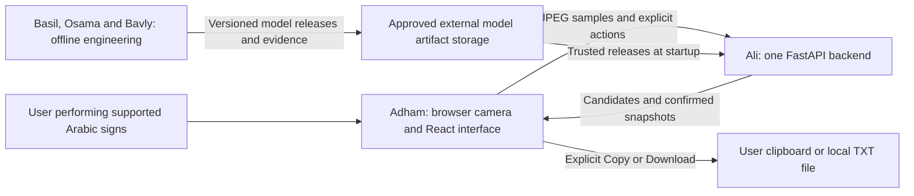
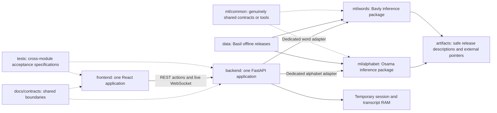
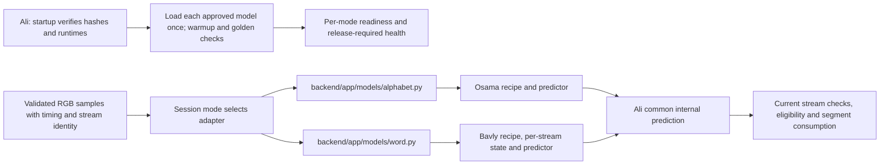

# Signova system overview

Status: architecture specification and scaffold, November 16, 2026. Owner: Hisham; technical review by all module owners. The five engineering handbooks and the current project instructions supply the technical requirements. Coordinate pending decisions with Hisham and affected owners. This document describes intended behavior, not an implemented system or measured capability.

## System context

The recognizer supports isolated Arabic letters and an approved isolated-word vocabulary. Its transcript accumulates confirmed glosses in signing order. Approved English equivalents come from a reviewed mapping; there is no English/ASL recognizer and no unrestricted sentence or grammar generator. The exact sign-language variety and English mapping delivery remain unresolved.

## Monorepo components

The model arrows represent Python package integration inside the backend runtime, not remote model servers. Offline training environments may differ, but both approved inference runtimes must coexist in the initial single backend process. No model service, message broker, database, Redis, multiworker orchestration or deployment infrastructure is scaffolded. Incompatibility blocks integration until the team resolves the runtime or model plan.

This is a modular monorepo because one repository holds separately owned modules, shared contracts and integrated review. It is not a microservices design: live requests use one frontend and one backend; the two model packages are loaded dependencies, not separately deployed network services. `data/` is an offline supply chain, never a live database.

## Model integration

Ali owns wire validation, scheduling and adapter translation. Model owners own the exact preprocessing semantics and callable inference packages; Ali reproduces or invokes that frozen recipe rather than inventing another transform. Basil versions the offline preparation and verifies parity. The browser does no MediaPipe extraction under v1. Pillow is the initial JPEG decoder; OpenCV/MediaPipe are conditional on the approved model recipe.

Weights are shared read-only where safe. Temporal windows, tracking state, hidden state, candidate gates and transcript data belong to a single session/stream. A reused stateful extractor must never carry one user's evidence into another session. Source imports from prediction must not pull in training entrypoints; model architecture and deterministic preprocessing have their own modules.

## Product surfaces and ownership

Adham owns Homepage, Live Translator (Alphabet/Word), Recognition Preview, Confirmed Transcript, transcript editing, explicit copy/download/clear, Sign Library, and About/Help. The same workspace can host both modes; switching mode ends the current session and creates a fresh one. Candidate previews and confirmed text are separate regions. Sign Library uses the model-compatible public vocabulary, with rights-cleared validated examples only.

Ali owns session capabilities, validation, model routing/loading, candidates, word gating, command identity and authoritative transcript snapshots. Osama owns alphabet science; Bavly owns word science and evaluated temporal/completion evidence. Basil owns source rights, labels, grouping/splits and reproducible dataset releases. Hisham coordinates contracts, QA and final acceptance.

## Storage and failure boundaries

Server session/transcript state exists only in RAM: initial idle 15 minutes, absolute 60 minutes, disconnected grace 2 minutes, earliest applicable deadline. End permits a short read/export review of at most 5 minutes capped by absolute expiry; its deadline precedence needs the decision recorded in the log. Browser display and drafts use tab memory. Explicitly opted-in recovery may use `sessionStorage` with enforced expiry; it is disarmed after Clear and removed by opt-out, End and Delete. No default recordings, automatic training collection, account history, permanent cloud transcript store or transcript backups exist.

One backend process, one worker and one replica are the initial runtime constraint. Restart destroys RAM sessions; a surviving local view or opted-in local copy must be labeled honestly. Downloads and clipboard copies belong to the user and cannot be recalled by Clear/Delete. See [runtime flows](runtime-data-flow.md), [data governance](../datasets/data-governance.md) and [integration acceptance](../runbooks/integration-checklist.md).
