# Offline dataset release contract

Owner: Basil; consumers: Osama and Bavly, with safe fixtures/metadata to Ali and Adham. Source: Basil §§3–13/16–24. Data is an offline engineering supply chain, never an application database or an automatic destination for live frames/corrections.

```mermaid
flowchart LR
  sources["Authorized pinned sources or separately consented collection"] --> intake["Basil: rights register, immutable originals and hashes"]
  intake --> audit["Photo/video inventory, semantic review and quarantine"]
  audit --> groups["Signer, recording, parent and duplicate grouping"]
  groups --> split["Frozen train, validation and sealed test manifests"]
  split --> recipes["Separate owner-approved preparation recipes"]
  recipes --> alphabet["Osama: train and validate alphabet"]
  recipes --> words["Bavly: train and validate words and boundaries"]
  alphabet --> evaluate["Frozen independent evaluation and runtime parity"]
  words --> evaluate
  evaluate --> releases["Versioned external model releases"]
  releases --> runtime["Ali: startup adapters; no training in API"]
```

## Source and sample metadata

Source register: `source_id`, origin/link or collection event, acquisition date, owner/contact, version, license evidence, permitted training/evaluation/distribution/demo uses, restrictions, consent reference where needed and approval status. Personal consent evidence/identity mappings are restricted and kept outside ordinary Git; a public source row contains only a safe reference. Unknown rights mean quarantine, not approval.

Basil's release uses UTF-8 CSV or JSONL with schema version and column dictionary. The future schema is specified here, not supplied as placeholder JSON. Resolve safe relative paths from an immutable release root, never a person's desktop.

| Field | Meaning and validation |
|---|---|
| `sample_id`, `asset_id` | Stable logical sample and exact derivative identity; unique within their separate registries |
| `relative_path`, `media_type` | Safe relative asset path; `image` or `video`, checked against decoded bytes |
| `sha256`, `bytes` | Exact asset hash (64 lowercase hex) and byte size |
| `label_id`, `label_status` | Stable ID; `verified`, `disputed`, `unreviewed`; approved supervised rows require verified labels |
| `source_id`, `rights_ref` | Traceable origin and restricted permission reference, no consent text |
| `signer_id`, `recording_session_id` | Legitimately known pseudonymous groups; absent signer identity stays explicitly unknown |
| `parent_sample_id`, `group_id` | Original/derivative lineage and connected leakage grouping |
| `width`, `height`, `duration_ms` | Decoded dimensions; image duration is null |
| `fps_info`, `frame_count` | Video timing/frame metadata; null for images, distinguish nominal rates from actual timestamps |
| `sign_start_ms`, `sign_end_ms` | Optional verified sign boundaries with units, within decoded duration |
| `split`, `pipeline_version` | `train`, `validation`, `test`; exact preparation version. Quarantined material is outside these manifests. |

Temporal annotation records include annotation/segment ID, parent sample, label, start/end milliseconds, annotator/reviewer references, review status and boundary-policy version. Require 0≤start<end≤duration, preserve source-to-derived timestamp mappings, and record ambiguity rather than inventing neutral intervals. Internal missing/unknown conventions must be explicit per column.

## Cleaning, splitting and preparation

Preserve authorized raw originals and hashes; derivatives record parent, recipe, before/after hashes, reviewer and reason. Cleaning decisions: keep, transform, quarantine or exclude. Decode fully under resource limits, inspect dimensions/orientation, labels, complete motion, corruption, duplicate/overlap groups and independent coverage. Blur/brightness metrics are review signals, not automatic proof of unusability. Do not crop away linguistic context, mirror signs routinely, discard interior missing steps or relabel all frames of a word video as complete words.

For unseen-signer claims, known signers plus parent/session/duplicate-connected groups remain on one side of each evaluation boundary. Split before augmentation or fitting statistics. Derivatives inherit parents' splits. Fit learned transforms on train only; validation chooses models/policies, sealed test assesses the frozen candidate. Unknown signer metadata limits generalization claims. Percent splits, class counts and dataset sizes are TBD until audited; a 70/15/15 example is not mandatory.

Each model separately approves representation, axes/shape/dtype, color/orientation/crop/pad, scaling/fitted parameters, feature extractor/version/order, temporal sampling/window/masks/gaps, class map and remaining loader operations. Avoid double preprocessing. Runtime parity uses exact asset hashes and owner-approved numerical tolerances. Current live transport caps must be compatible before training/release claims are accepted.

## Deliverable and acceptance

The external frozen dataset release includes README/first-batch instructions, data card, release metadata, reviewed semantic labels, separate alphabet/word train/validation/test manifests, authorized assets or access-controlled mounted location, annotations, separate recipes, owner-approved loader example, checksums, cleaning/exclusion/split reports and permitted fixtures. Git tracks only reviewed public-safe metadata and references. Full pseudonymous sample manifests can still be restricted; location alone does not make them publishable.

Basil and each receiver verify source rights, paths/hashes/decoding, labels/boundaries, grouping audit, class coverage, first train/validation batch, shape/dtype/time order and deterministic recipe from a fresh environment. Ali reproduces golden preprocessing; Adham receives only public-compatible vocabulary/help content. Record accepted version, receiver, date, defects and limited scope. Never mutate an accepted release in place.

Maintain dataset/schema/labels/split/recipe versions, test exposure, data defects, withdrawal decisions and model-to-data lineage. A withdrawal may affect assets, derivatives, distributed copies and trained artifacts; deleting a source does not prove removal of its influence from weights. Hisham and model owners decide replacement/retraining scope. No raw user sessions or transcript corrections enter this pipeline by default.
