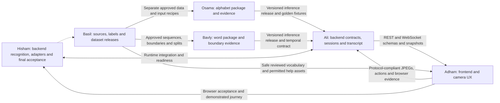

# Team handoffs and acceptance

Owner: Hisham. A handoff names a producing owner, receiving owner, immutable version, inputs/outputs, permitted evidence, known limits and a reproducible acceptance result. A filename alone is not acceptance. These are planned future checks, not completed deliveries.

| Handoff | Required contents | Receiver acceptance |
|---|---|---|
| Hisham → all | Supported variety/scope, priorities, dates, acceptance gates, unresolved decisions | Each owner can state its task, inputs/outputs and evidence without conflicting assumptions |
| Model owners → Basil | Separate representation, shape/dtype, labels, timing/boundaries, context, recipe/loader requirements | Basil can prepare the agreed representation without inventing masks or losing linguistic context |
| Basil → Osama/Bavly | Frozen dataset/split/label/recipe versions, authorized assets/access, manifests, reviewed boundaries where needed, data card, checksums, loader instructions, audit/limitations | Fresh receiver loads train/validation batches, verifies labels/shape/dtype/time order and grouping; record acceptance or defects |
| Osama/Bavly → Hisham and Ali | Manifest, trusted weights/export, ordered mapping, preprocessing, rejection/decision policy, runtime, predictor, ≥5 permitted golden fixtures, reports/model card/integration instructions/checksums | Fresh target-hardware environment loads once, warmup/golden/parity passes, invalid/unavailable input fails safely, versions recorded |
| Basil → Ali | Safe lineage/semantic IDs, exact recipe references, permitted parity fixtures and approved-use summary | Public/model map matches; offline/runtime first divergent stage is reproducible; no whole training archive needed |
| Ali → Adham | Exact REST/WS/version schemas, status/errors, sample snapshots, limits/deadlines, readiness, command identity and recovery behavior | Create/connect/start/preview/confirm/pause/edit/export/clear/end/delete plus outage cases work against explicit development fixtures before real models |
| Basil/model owners → Adham through Ali | Model-compatible public vocabulary, approved framing/variety/limitations and permitted help assets | UI displays approved facts only, with rights and version alignment; no unvalidated sign tutorial |
| Adham → Ali/model owners | Actual encoded orientation/aspect/size/rate, browser matrix and safe reproducible fixture failures | Same fixture through browser/server/model exposes first mismatch without private user recordings |
| All → Hisham | Compatible versions/checksums, meaningful tests, scientific reports, known limits, clean reproducibility and end-to-end demonstration | Acceptance by evidence; manual fallback and unavailable modes presented honestly |

Basil continues after first cleaning: maintain accepted releases, error/rights/withdrawal records, split/test exposure and model lineage; prioritize approved acquisition from validation evidence. Model owners maintain scientific regressions and immutable replacements. Hisham and Ali maintain the backend together. Adham maintains browser behavior, and Hisham coordinates scope and final QA.

Report first demonstrated divergence: source/label/split → Basil and qualified reviewer; training/model → relevant model owner; decode/adapter/gating → Hisham; sampler/render/draft/recovery → Adham. Include fixture/run/model/data/recipe IDs, expected/actual shape/timing/label and safe support IDs. Never attach session secrets, transcripts or unapproved media to general tickets. Live user corrections are not data handoffs.
